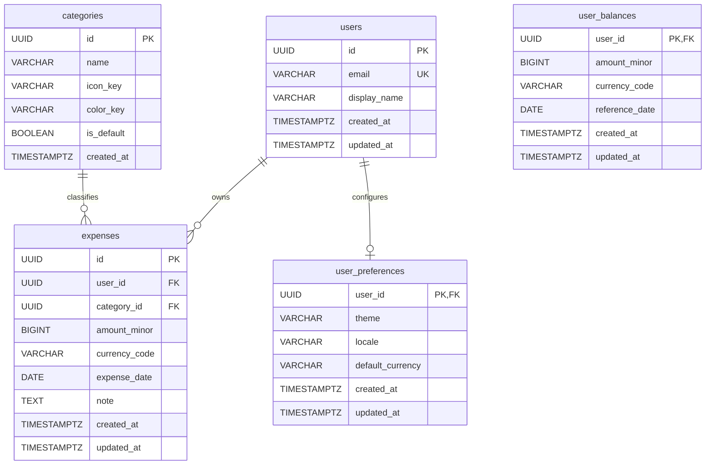

# DailyFlow Database Architecture

## 1. Schema Overview

DailyFlow uses a relational model designed for strict financial data integrity, high auditability, and performant temporal querying.
All monetary amounts are represented as integer minor currency units (`BIGINT amount_minor`), avoiding floating point rounding errors.

### Entities

---

## 2. Constraints & Indexes

1. **Foreign Keys**:
   - `expenses.user_id` -> `users.id` (`ON DELETE CASCADE`)
   - `expenses.category_id` -> `categories.id` (`ON DELETE RESTRICT`)
   - `user_preferences.user_id` -> `users.id` (`ON DELETE CASCADE`)

2. **Check Constraints**:
   - `amount_minor > 0`
   - `currency_code ~ '^[A-Z]{3}$'` (3-letter ISO 4217 code)

3. **Performance Indexes**:
   - `CREATE INDEX idx_expenses_user_date ON expenses (user_id, expense_date DESC);`
   - `CREATE INDEX idx_expenses_user_category_date ON expenses (user_id, category_id, expense_date DESC);`

---

## 3. Seed Data
Default seeded categories:
1. `Food & Dining` (`utensils`, amber)
2. `Transportation` (`car`, emerald)
3. `Education` (`graduation-cap`, blue)
4. `Shopping` (`shopping-bag`, violet)
5. `Bills & Utilities` (`zap`, rose)
6. `Health & Wellness` (`activity`, cyan)
7. `Entertainment` (`film`, orange)
8. `Other / Miscellaneous` (`more-horizontal`, slate)
